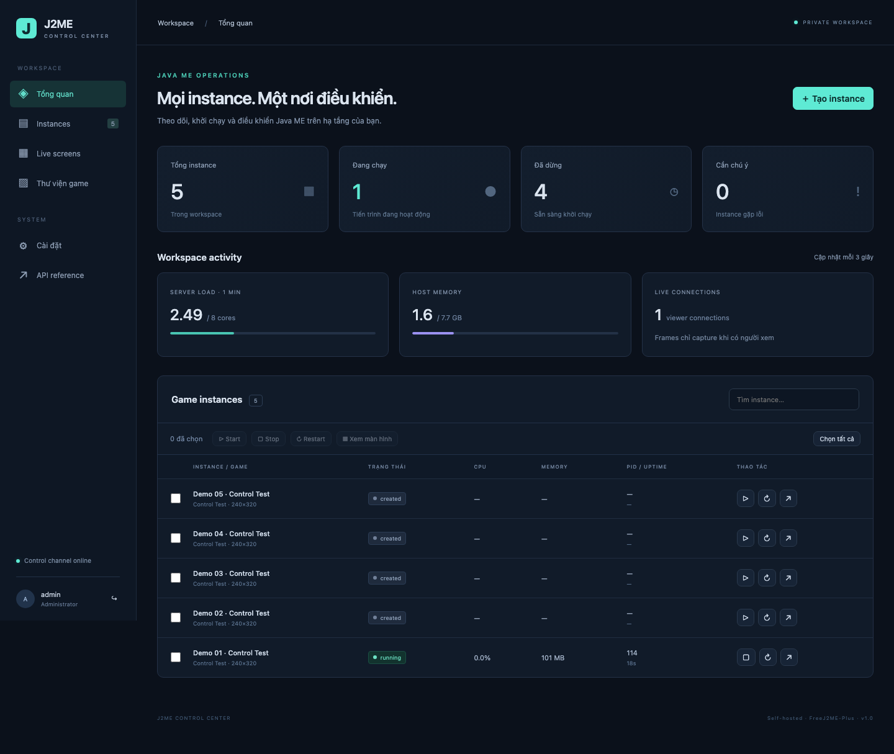
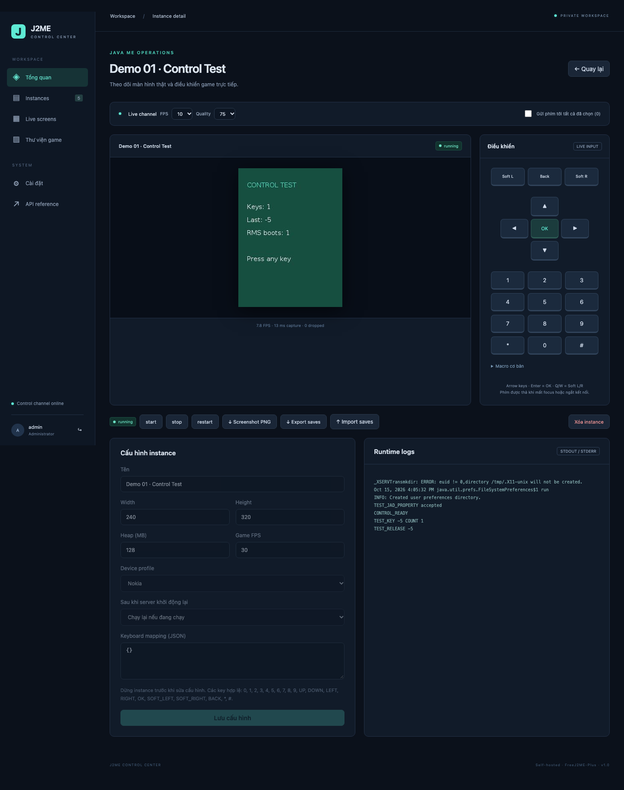

<div align="center">

# J2ME Control Center

### Game Java ME. Một dashboard. Hạ tầng của bạn.

Chạy, theo dõi và điều khiển nhiều game J2ME ngay trên trình duyệt — từ laptop đến điện thoại.

[](https://github.com/puma2k/j2me-control-center/actions/workflows/ci.yml)


[Khởi chạy](#khởi-chạy) · [Tính năng](#tính-năng) · [Hiệu năng](#hiệu-năng) · [Tài liệu](#tài-liệu)

</div>



## Từ file JAR đến màn hình chơi

J2ME Control Center là dashboard tự host cho game Java ME trên Linux headless. Upload JAR, tạo instance rồi chơi qua màn hình trực tiếp, bàn phím hoặc cảm ứng. Mỗi instance chạy trong một JVM và Xvfb riêng, có cấu hình và bộ nhớ lưu RMS độc lập.

Dự án dùng **React + Vite**, **Fastify + TypeScript**, **SQLite WAL** và lõi **FreeJ2ME-Plus**. Hình ảnh lấy từ framebuffer của giả lập; CPU và RAM được đo từ tiến trình thực.

## Tính năng

|                         | Làm được gì?                                                         |
| :---------------------- | :------------------------------------------------------------------- |
| **Thư viện game**       | Upload JAR, đính kèm JAD và tái sử dụng game cho nhiều instance.     |
| **Quản lý tập trung**   | Start, stop, restart, thao tác hàng loạt và xem log riêng từng game. |
| **Live screens**        | Xem lưới 1 / 2 / 4 / 9 màn hình, điều chỉnh FPS và chất lượng JPEG.  |
| **Gõ trực tiếp**        | Bàn phím laptop, bàn phím điện thoại, dán chữ, Unicode và IME.       |
| **Điều khiển game**     | Mũi tên, Enter, Backspace, gamepad trên màn hình, chạm và kéo.       |
| **Lưu tiến trình**      | RMS riêng từng instance; import/export save và backup dữ liệu.       |
| **Mạng TCP**            | Kết nối `socket://` qua triển khai SocketConnection thực.            |
| **Nghỉ màn hình**       | Sau 30 giây không thao tác, ngừng truyền ảnh; game vẫn chạy nền.     |
| **Theo dõi tài nguyên** | PID, uptime, CPU, RSS/PSS và thống kê luồng hình.                    |
| **API**                 | REST, WebSocket và Swagger có xác thực tại `/docs`.                  |

### Chạm để chơi. Rời tay để tiết kiệm.

Game và luồng màn hình mặc định đặt **60 FPS**. Khi không thao tác trong 30 giây, màn hình chuyển đen và trình duyệt hủy đăng ký luồng ảnh. Nếu không còn người xem khác, server ngừng chụp, nén và truyền ảnh; JVM, kết nối mạng và cấu hình FPS của game vẫn giữ nguyên.

Chạm hoặc bấm phím lần đầu để đánh thức; thao tác tiếp theo điều khiển game. Giữ phím hoặc giữ chạm không kích hoạt chế độ nghỉ. Tab ẩn cũng ngừng nhận ảnh. Mỗi trình duyệt có trạng thái nghỉ riêng.

<details>
<summary><strong>Xem màn hình điều khiển</strong></summary>



Ảnh minh họa giao diện từ một lần kiểm thử trước; cấu hình mặc định hiện tại là 60 FPS.

</details>

## Khởi chạy

Cần **Docker Engine + Compose v2**. Runtime giả lập chạy trên Linux; image đã được kiểm thử trên Linux arm64 và linux/amd64 qua Docker Desktop. Sức chứa phụ thuộc game và CPU thực tế của máy.

```sh
git clone https://github.com/puma2k/j2me-control-center.git
cd j2me-control-center
cp .env.example .env
```

Mở `.env`, đặt `ADMIN_PASSWORD` riêng có ít nhất 12 ký tự. Sau đó:

```sh
docker compose up -d --build
```

Truy cập **[localhost:3000](http://127.0.0.1:3000)** và đăng nhập bằng `ADMIN_USERNAME` / `ADMIN_PASSWORD` đã cấu hình.

1. Vào **Thư viện game**, upload JAR bạn có quyền sử dụng; tối đa 32 MiB/file.
2. Đính kèm JAD nếu game cần. JAD trỏ đến tên JAR local, không tự tải game từ URL.
3. **Tạo instance**, chọn game và đặt cấu hình.
4. Bấm **Start**, mở instance rồi chạm màn hình để gõ hoặc điều khiển.
5. Chọn nhiều instance và mở **Live screens** để theo dõi cùng lúc.

### Các cấu hình chính

| Thiết lập          | Mặc định  | Ý nghĩa                                                     |
| :----------------- | :-------- | :---------------------------------------------------------- |
| Game FPS           | `60`      | Mức đặt cho từng instance; FPS thực tế tùy game và tải máy. |
| `STREAM_FPS`       | `60`      | Mức đặt cho luồng xem; độc lập với game FPS.                |
| `STREAM_QUALITY`   | `60`      | Chất lượng JPEG của luồng hình.                             |
| Heap mỗi instance  | `128 MiB` | Trần heap Java; không phải tổng RAM của JVM.                |
| `MAX_INSTANCES`    | `5`       | Quota số game chạy đồng thời.                               |
| `MEMORY_BUDGET_MB` | `2048`    | Ngân sách admission ước lượng.                              |
| `CONTAINER_MEMORY` | `3g`      | Giới hạn RAM toàn container, không phải RAM luôn chiếm.     |
| `CONTAINER_CPUS`   | `2.0`     | Giới hạn CPU dùng chung cho toàn app.                       |

Toàn bộ biến môi trường nằm trong [`.env.example`](.env.example). Không commit `.env` và không dùng mật khẩu mẫu khi triển khai.

## Điều khiển

| Thao tác    | Cách dùng                                                   |
| :---------- | :---------------------------------------------------------- |
| Nhập chữ    | Chạm màn hình game rồi gõ; điện thoại dùng nút mở bàn phím. |
| Di chuyển   | Phím mũi tên hoặc gamepad.                                  |
| Xác nhận    | `Enter` / nút OK.                                           |
| Xóa chữ     | `Backspace`.                                                |
| Ẩn bàn phím | `Escape` hoặc nút ẩn bàn phím.                              |
| Cảm ứng     | Chạm, giữ và kéo trên màn hình game.                        |

Chữ được gửi trực tiếp, không cần bấm gửi. Q/W trong chế độ nhập là ký tự. Hành vi ô nhập tùy game; TextBox/Form chuẩn Java ME được hỗ trợ nhập trực tiếp và xác nhận bằng Enter. Screenshot tải xuống là PNG nguyên độ phân giải.

## Hiệu năng

Runtime dùng **Serial GC, C1 JIT**, heap khởi tạo nhỏ và giới hạn arena của bộ cấp phát native. Luồng ảnh lấy RGB qua tmpfs, bỏ bước chuyển PNG trung gian và chia sẻ JPEG mới mã hóa giữa các viewer cùng chất lượng. Giao diện cập nhật ảnh trực tiếp thay vì render lại cả dashboard mỗi frame.

Các phép đo ngắn trên **Apple M1 / Docker Desktop, Linux arm64**, một game do người dùng cung cấp ở menu online:

| Quan sát                                 | Kết quả                                |
| :--------------------------------------- | :------------------------------------- |
| RSS JVM trước / sau tối ưu bộ nhớ        | Khoảng **138 → 76 MiB**.               |
| CPU toàn app khi xem / khi màn hình nghỉ | Khoảng **44% → 9% một lõi**.           |
| RSS JVM khi xem / khi nghỉ               | Khoảng **78 MiB** ở cả hai trạng thái. |

Đây là các mẫu khoảng 10 giây ở menu, không phải cam kết cho mọi game, map đông người hoặc VPS. Mức đặt 60 FPS không đảm bảo mọi máy luôn đạt 60 FPS. Không suy ra số game tối đa bằng cách nhân các số trên.

Xem [phương pháp, số liệu và giới hạn benchmark](docs/BENCHMARKS.md). Đo heap/RSS của game đang chạy bằng:

```sh
scripts/profile-memory.sh
```

## Vận hành

```sh
# Trạng thái và log
docker compose ps
docker compose logs --tail=100 api

# Dừng tạm thời, giữ nguyên dữ liệu
docker compose stop

# Chạy lại
docker compose start

# Backup nhất quán; script tạm dừng dịch vụ
scripts/backup.sh
```

Dữ liệu game, metadata và RMS nằm trong Docker volumes. **Không chạy `docker compose down -v` nếu cần giữ dữ liệu.** Chính sách `restore-running` khởi động lại game sau khi service restart; không khôi phục trạng thái RAM đang chơi.

Khôi phục bằng `scripts/restore.sh /path/control-center.tar.gz` sẽ ghi đè dữ liệu; backup trước khi dùng. Script vận hành cần Bash; restore cần Python 3. Khi nâng cấp, giữ image cũ và backup để có đường rollback.

## Phạm vi hỗ trợ

Dự án phù hợp với mô hình **một quản trị viên, một host**, chạy JAR đáng tin cậy. Mỗi game có JVM riêng nhưng cùng container; đây **không phải sandbox cho mã độc** hay nền tảng multi-tenant.

- Mặc định chỉ bind localhost. Truy cập từ xa qua SSH tunnel/VPN; nếu công khai dashboard, cấu hình HTTPS, `COOKIE_SECURE` và `PUBLIC_ORIGIN` theo [reverse proxy](infra/compose.proxy.yml).
- Container chạy non-root, filesystem chỉ đọc, bỏ capabilities và không mount Docker socket.
- TCP socket được triển khai; HTTP/HTTPS trong lõi giả lập vẫn là stub. Audio bị tắt; khả năng chạy từng game và vendor API cần kiểm tra riêng.
- Không kèm game thương mại, tài khoản, save cá nhân hay mật khẩu. Không cam kết tương thích mọi MIDlet hoặc sức chứa 50–100 instance.

Xem [matrix tương thích](docs/COMPATIBILITY.md) và [phạm vi đã xác minh](docs/STATUS.md).

## Phát triển & kiểm thử

Cần **Node.js 24 LTS**. Docker cần thiết khi kiểm thử emulator.

```sh
npm ci
npm run lint
npm run typecheck
npm test
npm run build
```

Fixture `ControlTest` là MIDlet gốc của dự án, được build cùng image. Xuất fixture sau khi service chạy:

```sh
mkdir -p .cache
docker compose cp api:/opt/fixtures/control-test.jar .cache/control-test.jar
npx playwright install chromium
npm run test:e2e
```

Kiểm tra cục bộ đã ghi nhận **27 unit tests** và **8 E2E tests** qua, gồm nhập phím, pointer, save, xác thực WebSocket, năm JVM độc lập và chế độ nghỉ màn hình. Kết quả GitHub Actions được hiển thị riêng qua badge CI, không suy ra từ kết quả cục bộ.

Phát triển API bằng `npm run dev` sau khi cấu hình môi trường; UI bằng `npm run dev:web`. Các phép đo dài dùng `npm run benchmark` và `scripts/soak.sh`; chưa có kết quả soak 24 giờ được nghiệm thu.

## Tài liệu

| Tài liệu                                   | Nội dung                                          |
| :----------------------------------------- | :------------------------------------------------ |
| [Kiến trúc](docs/ARCHITECTURE.md)          | API, runtime, dữ liệu và đường đi frame/input.    |
| [API reference](docs/API.md)               | REST và WebSocket; Swagger trực tiếp tại `/docs`. |
| [Benchmark](docs/BENCHMARKS.md)            | Số đo, điều kiện thử và giới hạn suy luận.        |
| [Verification](docs/VERIFICATION.md)       | Các kiểm tra đã thực hiện.                        |
| [Troubleshooting](docs/TROUBLESHOOTING.md) | Chẩn đoán lỗi thường gặp.                         |
| [Trạng thái dự án](docs/STATUS.md)         | Phần đã có và phần chưa được xác minh.            |

## Giấy phép & ghi nhận

UI/API và fixture `ControlTest` dùng **MIT**. `runtime/Bridge.java` cùng lõi FreeJ2ME-Plus thuộc **GPL-3.0-or-later**; các thành phần khác giữ giấy phép riêng. Xem [LICENSE](LICENSE) và [third-party notices](docs/THIRD_PARTY.md) trước khi phân phối.

FreeJ2ME-Plus được pin tại commit `baca76a4dda6f30abac67fb4a3db009eed05f91c`. Source và giấy phép của emulator/bridge được giữ trong Docker image.
