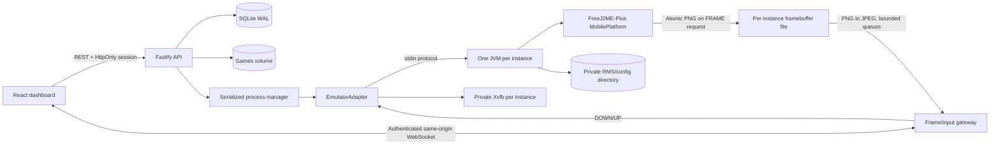

# Architecture

Monorepo: `apps/web` React/Vite; `apps/api` Fastify, auth/store/library/manager/stream; `packages/shared` Zod types and key protocol; `runtime` adapter interface, process adapter, GPL Java bridge; `infra` Docker and proxy example.

API serves SPA statically; only HTTP port exposed. Runtime is isolated as a module behind start/stop/restart/sendKey/captureFrame/getStatus/getLogs/getMetrics. Replacing runtime adapter does not alter UI/API.

Game files use SHA-256 IDs. Metadata, settings, sessions and audit events are persisted in SQLite with FK constraints, WAL, schema user_version and transactional migration. Save/config directories use generated UUIDs. No arbitrary path/command parameters. Upload checks ZIP magic, directory entries, symlinks, encryption, duplicate names, count, expansion ratio/size, streamed CRC and MIDlet manifest/class. JAD URLs are restricted to local filenames and rewritten to the associated content ID; the pinned emulator automatically discovers matching sidecar JAD.

Lifecycle operations serialize through a manager queue; maximum start concurrency is one. Start admission reserves heap+128MB and counts current active processes. States are persisted and broadcast. Startup reconciles stale active states; restore-running restarts only previously active opted-in instances. Unexpected exit cleans up the pair and retries at most twice (1s/2s) for restore-running policy. Stop cancels pending retries. SIGTERM gracefully stops process groups. Docker init and cgroup teardown handle container death.

Direct Java bridge accesses real MobilePlatform framebuffer and key events. It does not render mock images or fake key effects. Frames are produced on demand, atomically replaced; capture is coalesced per instance. Each viewer has a sequential timer with bounded WS buffered bytes and dropped stale frames. No viewers means no capture. Game simulation continues independently. WS per-connection key ownership releases all keys on disconnect. Physical browser keys release on blur/visibility loss. Session validation applies to upgrades and periodic revocation.

Total container cgroup limits apply. Per-JVM heap caps and memory admission do not cap native RSS, CPU or outbound network separately. This single-admin deployment assumes trusted game code. Multi-worker orchestration and hostile-code sandboxes need a separate design and deployment boundary.
